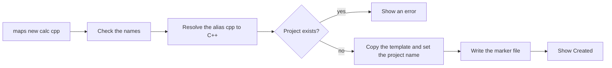

<div align="center">

# MAPS

**Modular Architecture Project Scaffolder**

A command-line tool that makes and organizes project folders by language.


[Overview](#overview) · [Quick start](#quick-start) · [Commands](#commands) · [Templates](#templates) · [Safety](#safety-rules) · [Testing](#testing) · [Roadmap](#roadmap)

</div>

---

## Table of contents

- [Overview](#overview)
- [Features](#features)
- [Demo](#demo)
- [Quick start](#quick-start)
- [Commands](#commands)
- [How it works](#how-it-works)
- [Templates](#templates)
- [Safety rules](#safety-rules)
- [Configuration and files](#configuration-and-files)
- [Testing](#testing)
- [Source overview](#source-overview)
- [Limits](#limits)
- [Roadmap](#roadmap)
- [Contributing](#contributing)
- [AI usage](#ai-usage)
- [License](#license)
- [Credits](#credits)

## Overview

MAPS makes a new project with one command. It copies a template, names the project, and puts it in a fixed folder structure. It sorts every project by programming language.

Class projects and personal projects cause two problems. For a beginner it is a common struggle to move between project folders that causes confusion and disorganization. MAPS solves both problems with a small set of commands.

The design follows command-line tools such as npm. MAPS uses fewer and simpler commands.

**The name**

| Word | Meaning |
|---|---|
| Modular | The language templates can grow. The user adds the templates that the programmer needs. The templates that exist already work. |
| Architecture | MAPS keeps a fixed structure: head folder, language folder, project folder. |
| Project | The unit that MAPS makes and tracks. |
| Scaffolder | The scaffold function is part of MAPS. The programmer can use it at any time. |

## Features

- **One command to start a project.** MAPS makes the folder, the starter files and the marker file.
- **Language folders.** Projects are sorted by language: `C++`, `PY`, `JS`, `WEB` and more.
- **Template folders.** A template is a normal folder of files. Add a language with no code change.
- **Aliases.** `cpp`, `c++` and `cc` all give the folder `C++`.
- **Import.** Move an existing project folder into the correct place.
- **Marker file.** `maps list` shows only the projects that MAPS knows. Other folders stay out of the list.
- **Safety rules.** MAPS refuses to move system folders and asks before it changes the head folder.
- **No dependencies.** MAPS uses the C++ standard library only.
- **Test suite.** `test.bat` runs 54 test cases in a sandbox.

## Demo

```
> maps new calc cpp
Created C:\Users\you\MAPS\C++\calc

> maps new site web
Created C:\Users\you\MAPS\WEB\site

> maps list
C++
	calc
WEB
	site
```

Import a project that is in another place:

```
> maps import C:\Users\you\Downloads\rofind-react web
Move from: C:\Users\you\Downloads\rofind-react
Move to  : C:\Users\you\MAPS\WEB\rofind-react
Move the folder? (y/n): y
Imported C:\Users\you\MAPS\WEB\rofind-react
```

MAPS refuses to move a system folder:

```
> maps import C:\Windows web
Error: this folder is protected, it is a drive root or a top level folder.
```

Show where MAPS keeps its files:

```
> maps info
Head folder : C:\Users\you\MAPS
Templates   : C:\Users\you\AppData\Roaming\MAPS\templates
Settings    : C:\Users\you\.maps_config  (not set, default head folder in use)
Marker file : .maps (inside each project)
```

## Quick start

### Requirements

| Item | Value |
|---|---|
| System | Windows (Linux and macOS are planned) |
| To build | `g++` from GCC 9 or newer, on the `PATH`. Use `-std=c++20` or `-std=c++17`. |
| To run | No compiler. You need `maps.exe` and the templates. If Windows reports a missing DLL, build with `-static`. |
| Libraries | None |

> **Note:** Dev-C++ 5.11 uses GCC 4.9.2. This compiler cannot build the `<filesystem>` header. Do not use it.

On Windows, MSYS2 and WinLibs both give a MinGW-w64 version of `g++`.

### Build

**Before you start make sure to have g++ installed in your machine. You can get g++ here [MingGW SourceForge](https://sourceforge.net/projects/mingw-w64/)**

**Check g++ version**

1. Open a terminal.
2. Enter `g++ --version`.
3. Make sure that the version is 9 or newer.

**Build with `build.bat`**

1. Open a terminal in the project folder.
2. Enter `build.bat`.

Result: `build.bat` makes the `build` folder and compiles the program. It copies the templates to AppData and shows the help text.

> **Note:** `build.bat` stops with an error if `g++` is not on the `PATH`.

**Build by hand**

1. Open a terminal in the project folder.
2. Enter `mkdir build`.
3. Enter this command:

```
g++ -std=c++20 ./src/main.cpp -o ./build/maps.exe
```

Result: the file `build\maps.exe` is in the project folder.

> **Note:** To run `maps.exe` on a PC that has no MinGW, add `-static` to the command.

### Install

1. Run `build.bat`.
2. Make a permanent folder, for example `C:\Tools\MAPS`.
3. Copy `build\maps.exe` to this folder.
4. Open the Start menu.
5. Enter `environment variables`.
6. Select **Edit the system environment variables**.
7. Select **Environment Variables**.
8. Select **Path**, then select **Edit**.
9. Select **New**.
10. Enter the path of the permanent folder.
11. Select **OK** in each window.
12. Close the terminal. Open a new terminal.
13. Enter `maps help`.

Result: the terminal shows the help text.

> **Note:** `build.bat` copies the templates to `%APPDATA%\MAPS\templates`. The program reads them from this folder. The path does not depend on where `maps.exe` is.

**Install on a PC that has no source code**

1. Copy `maps.exe` to a permanent folder and add the folder to the `PATH`.
2. Make the folder `%APPDATA%\MAPS`.
3. Copy the `templates` folder into the folder `%APPDATA%\MAPS`.
4. Enter `maps templates`.

Result: the terminal shows the templates folder and its languages.

### First project

1. Open a terminal.
2. Enter `maps new hello cpp`.
3. Enter `maps list`.

Result: the list shows the folder `C++` and the project `hello`.

## Commands

| Command | Action |
|---|---|
| `maps new <name> <lang> [type]` | Make a project from a template. |
| `maps import <path> <lang>` | Move a project folder into the head folder. |
| `maps list` | Show all projects, grouped by language. |
| `maps templates` | Show the installed templates. |
| `maps root` | Show the head folder. |
| `maps root <path>` | Change the head folder. |
| `maps root reset` | Set the head folder back to the default. |
| `maps info` | Show where MAPS keeps its files. |
| `maps help` | Show the help text. `-h`, `--help` and `?` do the same. |

### `maps new`

```
maps new <name> <lang> [type]
```

- `<name>` is the project name.
- `<lang>` is a language or an alias, for example `cpp`, `py`, `js`, `web`.
- `[type]` is the template type. The default is `default`.

The command refuses an existing project and a name with bad characters.

### `maps import`

```
maps import <path> <lang>
```

The command moves the folder to `<head folder>\<LANG>\<name>` and writes the marker file. It shows the old and the new path and asks `Move the folder? (y/n)`. See [Safety rules](#safety-rules).

If the folder is already in the right place, the command only writes the marker file.

**Import a project**

1. Close each program that uses the folder, for example your editor.
2. Enter `maps import <path> <lang>`.
3. Read the old path and the new path.
4. Enter `y` to move the folder. Enter `n` to cancel.

Result: the folder is in `<head folder>\<LANG>\<name>`. The command `maps list` shows it.

> **Note:** The old folder and the new folder must be on the same drive.

### `maps root`

**Change the head folder**

1. Make the new folder.
2. Enter `maps root <full path>`.
3. Read the old folder and the new folder.
4. Enter `y` to change the head folder. Enter `n` to cancel.

Result: MAPS uses the new folder.

> **Note:** The old projects stay in the old folder. MAPS does not move them.

To go back to the default folder, enter `maps root reset`.

## How it works

### Folder structure

```
MAPS\                      head folder
	C++\                   language folder
		calc\              project folder
			.maps          marker file
			README.md
			main.cpp
	PY\
	WEB\
```

### The `new` command



### Marker file

The command `maps new` writes a `.maps` file in each project. The command `maps list` shows only folders that have this file. Other folders in the head folder do not show.

## Templates

A template is a folder. It holds the starter files of a project.

```
templates\
	aliases.txt
	C++\
		default\
		structured\
	PY\
		default\
```

| Rule | Detail |
|---|---|
| Path | `templates\<language>\<type>\` |
| Default type | `default`, used when the user gives no type |
| Copy | All files and sub-folders of the type folder, including empty folders |
| Placeholder | `{{name}}` becomes the project name, in file contents and in file names |
| Aliases | `aliases.txt` has one alias on each line, for example `cpp=C++` |

> **Note:** Change the templates in the project folder. Do not change them in AppData. `build.bat` copies the project templates to AppData and replaces the files there.

### Languages

MAPS does not detect the language of a project. The user gives the language in the command.

MAPS knows a language only when a template folder or an alias exists for it. Then MAPS uses the correct language folder, for example `cpp` gives `C++`.

If MAPS does not know the language, it makes the language folder from the name in uppercase, for example `rust` gives `RUST`. The project has only a `README.md` and the marker file. MAPS shows a note.

To add a language, make a template folder and add an alias. See [Add a language](#add-a-language).

### Add a template type

1. Open the folder `templates\<language>\` in the project folder.
2. Make a new folder. Use a lowercase name, for example `console`.
3. Put the starter files in the new folder.
4. Write `{{name}}` where the project name must show.
5. Run `build.bat`.
6. Enter `maps new calc cpp console`.

Result: the new project has the files of the `console` template.

### Add a language

1. Make the folder `templates\RUST\default\` in the project folder.
2. Put the starter files in this folder.
3. Open the file `templates\aliases.txt`.
4. Add the line `rs=RUST`.
5. Save the file.
6. Run `build.bat`.
7. Enter `maps new demo rs`.

Result: the project is in the folder `RUST` and has the starter files.

> **Note:** No code change is necessary.

## Safety rules

A wrong folder choice can make folders in the wrong place or move important files. These rules prevent this.

### Head folder

| Rule | Reason |
|---|---|
| The path must be a full path. | A short name makes a folder in the current folder. |
| The folder must exist. | A typing error does not make new folders. |
| A drive root and the program folder are refused. | These folders are not safe for projects. |
| The old and the new folder are shown, and the user must answer `y`. | The user sees the change before it happens. |

`maps root reset` goes back to the default.

### Import

`maps import` refuses these folders:

| Folder | Examples |
|---|---|
| Drive roots and top-level folders | `C:\`, `C:\Windows`, `C:\Users` |
| System and program folders, and all folders inside them | `C:\Windows\System32`, `C:\Program Files\...`, `C:\ProgramData\...`, AppData |
| The home folder | `C:\Users\you` |
| User folders | `Documents`, `Desktop`, `Downloads`, `Pictures`, `Music`, `Videos`, `OneDrive` |
| Settings folders in the home folder | `.ssh`, `.vscode` |
| The folder that holds the program | The source folder of MAPS |
| MAPS folders | The head folder and the language folders |

Folders inside `Documents` or `Desktop` are allowed.

The move needs the same drive. If the move fails, the original folder stays where it is.

### Names

The program rejects names that have these characters: `< > : " / \ | ? *`

## Configuration and files

| Item | Location |
|---|---|
| Head folder | `%USERPROFILE%\MAPS` (default) |
| Settings file | `%USERPROFILE%\.maps_config` |
| Templates | `%APPDATA%\MAPS\templates` |
| Marker file | `.maps`, inside each project |

The settings file holds one line: the path of the head folder. The program does not write in its own folder, because a folder such as Program Files can be read-only.

## Testing

`test.bat` runs 54 test cases against `build\maps.exe`. It prints each command, its output and a `PASS` or `FAIL` result.

**Run the tests**

1. Run `build.bat`.
2. Open a terminal in the project folder.
3. Enter `.\test.bat`.
4. Read each `[PASS]` or `[FAIL]` line.
5. Read the result at the end.

Result: the result is green when all tests pass. The result is red when a test fails.

| Option | Action |
|---|---|
| `keep` | Keep the sandbox to look at the projects. |
| `nopause` | Do not wait at the end. |
| `nocolor` | Print plain text. |

The tests cover these areas:

| Area | Tests |
|---|---|
| Usage and basics | 01-08 |
| `new` | 09-20 |
| `root` | 21-28 |
| `import` | 29-37 |
| Protected folders | 38-53 |
| `info` | 54 |

The test uses a `test_sandbox` folder in the project folder. Your real settings, head folder and templates are not changed. Every test of a protected folder answers `n`, so no folder can move.

## Source overview

The program is one file: `src/main.cpp`.

| Function | Job |
|---|---|
| `main` | Reads the command and calls one function. |
| `newProject` | Makes a project from a template. |
| `importProject` | Moves a project into the head folder. |
| `protectedReason` | Gives the reason a folder must not be moved. |
| `copyTemplate` | Copies a template folder. It calls itself for each sub-folder. |
| `languageFolder` | Turns an alias into a language folder name. |
| `listProjects` | Shows the projects that have a marker file. |
| `setRoot`, `resetRoot` | Change or reset the head folder. |
| `render` | Replaces `{{name}}` with the project name. |
| `isValidName` | Rejects bad names. |

Programming concepts in the code: file handling (`ifstream`, `ofstream`), the filesystem library, recursion, strings, command-line arguments, exceptions, input checks, and conditional compilation.

## Limits

- MAPS runs on Windows only.
- MAPS does not download templates.
- MAPS does not delete projects.
- MAPS does not detect the language of a project. The user gives it. `maps import` does not read the files of the project.
- `maps list` looks two levels down: head folder, language folder, project folder.
- The marker file `.maps` is not hidden on Windows.
- Templates in AppData follow the project templates only when `build.bat` runs. A template that you delete in the project stays in AppData.

## Roadmap

- [x] `new`, `import`, `list`, `templates`, `root`, `info`
- [x] Template folders with aliases and types
- [x] Marker file
- [x] Safety rules for the head folder and for import
- [x] Test suite
- [ ] Linux and macOS support
- [ ] A command to remove a project from the list
- [ ] Download templates, for example with `git clone`
- [ ] A numbered menu mode
- [ ] A user template folder that overrides the program templates
- [ ] An installer program for Windows
- [ ] A project that shows in more than one group

## Contributing

1. Make a branch.
2. Change the code or the templates.
3. Run `build.bat`.
4. Run `test.bat`.
5. Make sure that all tests pass.
6. Open a pull request.
7. Describe the change in short sentences.

---

## AI usage

This project uses AI-generated code. Most of the code in `src/main.cpp`, the templates, the scripts and the documentation drafts were written with AI tools, mainly Claude (Anthropic).

The team reviewed and edited all AI-generated code. The team also built the program and tested it on Windows.

The team is responsible for the final project.

## License

GNU General Public License v3.0 | https://choosealicense.com/licenses/gpl-3.0/.

## Credits

- Jasper Kyle F. Balinas
- Rafael Dominic C. Gabriel
- Terence Jerrome Montecillo
- Rionne J. Punto

M.A.P.S by Taurus Software.
FEU Institute of Technology.
Creation date: 11/12/2026.